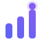
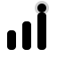
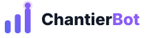
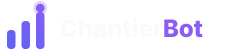
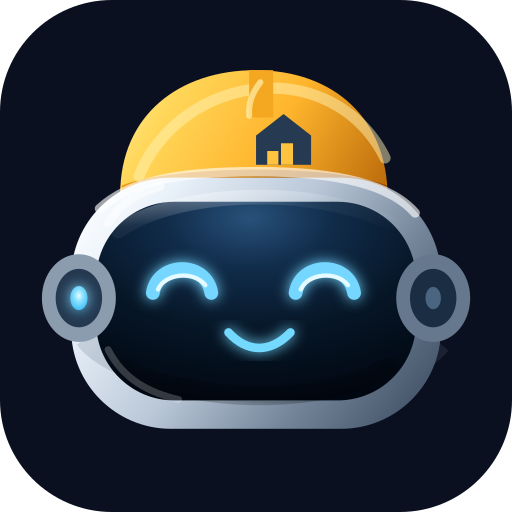

# Brief logo

## Objectif
Créer un symbole simple, mémorisable et reconnaissable.

## Concept
Mélange abstrait de :
- construction
- technologie
- progression
- IA

## Versions nécessaires
- Logo principal
- Logo horizontal
- Icône seule
- Version claire
- Version sombre
- Version monochrome
- Favicon

## Style
Minimal, premium, moderne.
Éviter les logos trop complexes ou trop illustratifs.

## Livré

Concept retenu : trois barres ascendantes (silhouette de construction + progression), la plus haute se terminant par un nœud/signal (IA), dans le gradient signature Electric Blue → Electric Violet.

Fichiers dans [`/static/logo`](../../static/logo) (servis directement par l'app à la racine `/logo/...`) :

| Version | Fichier | Aperçu |
|---|---|---|
| Icône seule | `icon.svg` |  |
| Icône monochrome (`currentColor`) | `icon-mono.svg` |  |
| Logo horizontal — fond clair | `logo-horizontal-light.svg` |  |
| Logo horizontal — fond sombre | `logo-horizontal-dark.svg` |  |
| Favicon | `/favicon.svg` (racine `static/`) |  |

Le logo principal = version horizontale ; la version claire et la version sombre couvrent les usages sur fond clair/sombre ; `icon-mono.svg` sert de version monochrome (hérite de la couleur du texte via `currentColor`).

Intégré dans l'app : en-tête (`src/routes/+layout.svelte`) et favicon (`src/app.html`).
